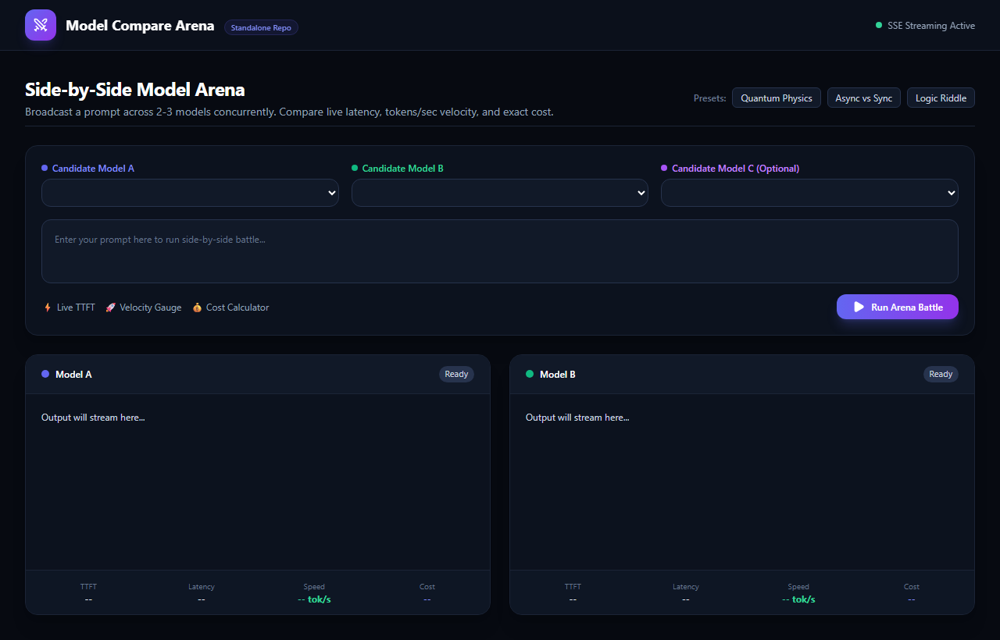

# ⚔️ Model Compare Arena

A modern, responsive side-by-side LLM benchmark arena that broadcasts a single prompt across 2–3 OpenAI-compatible models concurrently, tracking real-time latency, token velocity, and estimated USD cost.



---

## ✨ Features
- **Concurrent Server-Sent Events (SSE)**: Streams responses from multiple providers simultaneously into synchronized response cards.
- **Metrics HUD Panel**:
  - **TTFT (Time-To-First-Token)** in seconds.
  - **Total Latency** in seconds.
  - **Velocity** in tokens per second (`tok/s`).
  - **Estimated Cost per Call** calculated using real-time prompt and completion token counts against configurable pricing tables.
- **Provider Abstraction**: Works seamlessly with Groq, Together AI, OpenRouter, OpenAI, Local Ollama, and LM Studio.
- **Offline Mock Engine**: Test the UI, streaming animations, and latency gauges out-of-the-box with zero API keys required.

---

## 📦 How & Where to Get Models

The Arena connects to any OpenAI-compatible model endpoint configured in `config.yaml`:

### 1. Cloud Providers (High-Speed & Free Tiers)
- **Groq Cloud (Recommended for Speed)**: Get a free API key at [console.groq.com](https://console.groq.com/). Supported models: `llama-3.3-70b-versatile`, `llama-3.1-8b-instant`.
- **OpenRouter (Multi-Provider Aggregator)**: Get an API key at [openrouter.ai](https://openrouter.ai/). Offers access to free models like `google/gemini-2.0-flash-exp:free` and frontier models like DeepSeek V3.
- **Together AI**: Get an API key at [together.ai](https://api.together.xyz/). Supports Llama 3.1 70B Turbo and open-source models.

### 2. Local Models (100% Free & Private)
- **Ollama**: Download from [ollama.com](https://ollama.com/). Run:
  ```bash
  ollama run llama3.2
  ```
  Set base URL to `http://localhost:11434/v1` in `config.yaml`.
- **LM Studio**: Download from [lmstudio.ai](https://lmstudio.ai/). Start the local server at `http://localhost:1234/v1`.

---

## 🚀 Installation & Setup

### 1. Clone & Navigate
```bash
git clone https://github.com/shamishah0310-hash/model-compare-arena.git
cd model-compare-arena
```

### 2. Install Dependencies
```bash
pip install -r requirements.txt
```

### 3. Configure API Keys (Optional)
Copy `.env.example` to `.env` and add your keys:
```bash
cp .env.example .env
```
*(If no keys are added, select the **Mock Fast 7B** model in the UI for instant offline testing).*

### 4. Run the Arena
```bash
python app.py
```
Open **[http://127.0.0.1:8081](http://127.0.0.1:8081)** in your browser.
